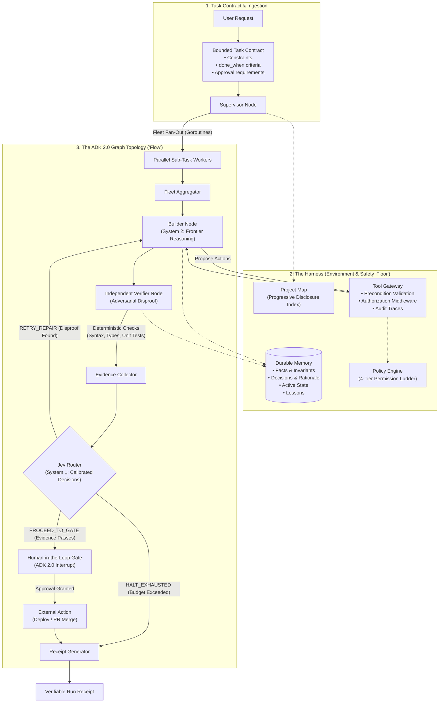

# High-Throughput Agentic Architecture (Go ADK 2.0 + Jev)

A production-grade, code-first AI agent architecture built in **Go** following **Google ADK 2.0 principles**, featuring a two-tier cognitive model (**System 2 Frontier Planning + System 1 Jev Typed Decisions**), an evidence-based loop, and a secure execution harness.

---

## 1. System Architecture Diagram



---

## 2. Core Architectural Principles

### A. The Two-Tier Cognitive Model
* **System 2 (Frontier Model — e.g. Gemini 2.0 / Astra):** Handles creative reasoning, architectural synthesis, and code generation.
* **System 1 (Jev — TypeSafe AI):** Handles ultra-fast, low-latency, schema-guaranteed routing, guardrail validation, and disproof scoring with calibrated confidence.
* **Deterministic Runtime (Go Engine):** Compiles code, runs tests, and checks linters directly.

### B. The Three System Layers
1. **The Harness ("The Floor"):**
   * **Task Contracts:** Binds natural language into measurable contracts with explicit `done_when` criteria.
   * **Progressive Disclosure:** Provides a high-level project map (attention index) rather than bloating the context window with raw files.
   * **Tool Gateway:** Sits between the model and the environment. Validates preconditions and enforces a 4-tier permission ladder (`LowRisk`, `Reversible`, `ExternalEffect`, `Irreversible`).
   * **Durable Memory:** Persists structured state (`Facts`, `Decisions`, `State`, `Lessons`) outside of the conversation transcript.
2. **The Graph ("The Flow"):**
   * Built on **ADK 2.0 StateGraph** with explicit nodes, conditional edges, and interrupt gates.
   * Enforces strict **Builder vs. Verifier separation** to prevent self-review bias.
   * Orchestrates parallel worker fleets using lightweight Go routines.
3. **The Loop ("The Feedback"):**
   * **Evidence-Based Gating:** Loop exit requires deterministic proof (exit code 0, test results, syntax checks) rather than model self-confidence.
   * **Run Receipts:** Compiles execution history into an auditable receipt detailing modified files, verified claims, and remaining risks.

---

## 3. Directory Layout

```
.
├── cmd/
│   └── agent/
│       └── main.go              # Complete end-to-end runnable demo
└── pkg/
    ├── contract/
    │   └── contract.go          # TaskContract, Evidence, and Receipt models
    ├── harness/
    │   ├── gateway.go           # Tool Gateway with preconditions & audit traces
    │   ├── permissions.go       # 4-tier Permission Ladder & Policy Engine
    │   ├── projectmap.go        # Progressive disclosure attention index
    │   ├── state.go             # Durable memory (Facts, Decisions, Lessons)
    │   └── tools.go             # Concrete typed tool definitions
    ├── jev/
    │   ├── client.go            # Jev client (calibrated System 1 decision engine)
    │   └── types.go             # Typed routing decisions and verifier scores
    ├── graph/
    │   ├── graph.go             # ADK 2.0 StateGraph engine & interrupts
    │   └── state.go             # Typed AgentState model
    └── nodes/
        ├── supervisor.go        # Parallel fleet fan-out
        ├── builder.go           # Solution generator via ToolGateway
        ├── verifier.go          # Adversarial disproof verifier
        ├── router.go            # Jev-driven dynamic conditional edge router
        ├── human_gate.go        # Human-in-the-loop (HITL) checkpoint
        └── receipt_node.go      # Final proof-based receipt generator
```

---

## 4. Quickstart

Run the complete pipeline:

```bash
go run ./cmd/agent/main.go
```