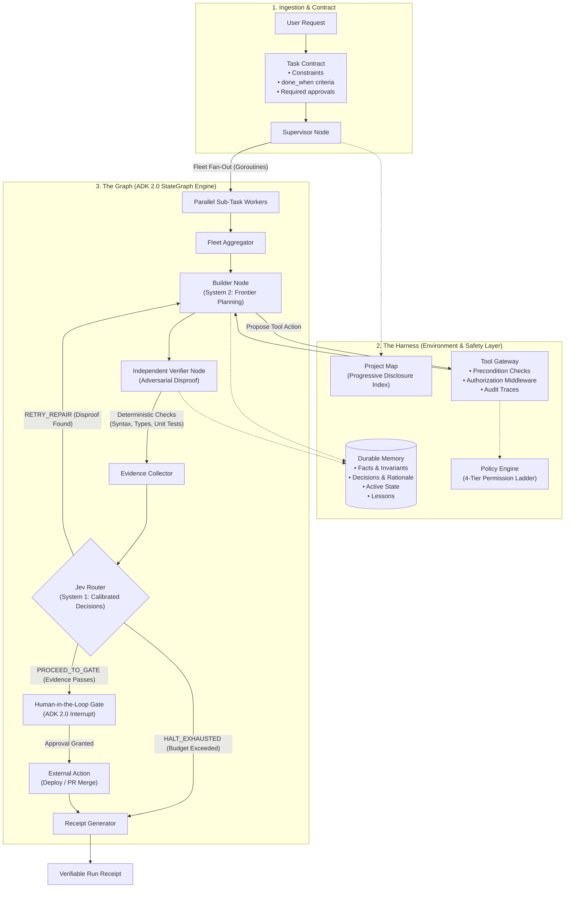

# Architecture Specification: Go ADK 2.0 + Jev

This document provides a detailed technical specification of the agent architecture implemented in this repository.

---

## 1. System Topology & Flow

---

## 2. The Three Architectural Layers

### Layer 1: The Harness (Environment, Policy & Attention Floor)
The Harness controls what an agent can safely observe, access, and mutate:

1. **Bounded Task Contracts (`pkg/contract/contract.go`):**
   * Translates unconstrained natural language instructions into a structured `TaskContract`.
   * Enforces explicit negative constraints (e.g., *"do not touch authentication schema"*) and positive `done_when` criteria.
2. **Progressive Disclosure (`pkg/harness/projectmap.go`):**
   * Context windows are treated as a constrained attention budget rather than storage.
   * A structured `ProjectMap` exposes an index of repository systems. Detailed files and local instructions are only loaded on demand.
3. **Tool Gateway & Permission Ladder (`pkg/harness/gateway.go`, `pkg/harness/permissions.go`):**
   * Eliminates direct LLM-to-environment tool execution.
   * The model proposes actions; the gateway validates preconditions; the policy engine authorizes execution across four risk tiers:
     * `LowRisk`: Inspection and search (Automatic execution).
     * `Reversible`: Workspace file edits and testing (Automatic execution + audit trace).
     * `ExternalEffect`: Staging deploys, network writes (Human approval required).
     * `Irreversible`: Production releases, schema drops (Hard gate).
4. **Durable Memory (`pkg/harness/state.go`):**
   * Memory is externalized from the LLM conversation transcript.
   * State is stored across four explicit domains: `Facts`, `Decisions`, `State`, and `Lessons`.

---

### Layer 2: The Graph (Topology & Orchestration)
The Graph coordinates workflow execution using the **Google ADK 2.0 StateGraph** engine:

1. **Supervisor Fan-Out:**
   * Decomposes the task contract into sub-tasks and executes them concurrently using Go goroutines.
2. **Decoupled Builder vs. Verifier:**
   * **Builder Node:** Responsible for creative synthesis and candidate implementations.
   * **Verifier Node:** An independent node operating under an adversarial mandate to disprove the candidate and identify edge cases.
3. **Human-in-the-Loop (HITL) Interrupts:**
   * High-risk operations pause execution cleanly via state checkpoints until human authorization is granted.

---

### Layer 3: The Loop (Evidence-Driven Verification & Cognition)

1. **Two-Tier Cognitive Separation:**
   * **System 2 (Frontier Model):** Handles high-level reasoning, code generation, and complex synthesis.
   * **System 1 (Jev — TypeSafe AI):** Handles sub-50ms routing decisions, schema validation, and disproof scoring with calibrated confidence.
2. **Evidence-Based Gating:**
   * Stop conditions require affirmative proof from deterministic tools (exit code `0` from compilers, tests, and linters). The model's self-reported confidence is never accepted as an exit criterion.
3. **Verifiable Run Receipts:**
   * Graph completion compiles an auditable receipt documenting changed files, verified claims, and remaining risks.

---

## 3. Comparison with Traditional Agent Architectures

| Dimension | Traditional Agent Architectures | This Architecture (Go ADK 2.0 + Jev) |
| :--- | :--- | :--- |
| **Control Flow** | Uncontrolled `while` prompt loop | **ADK 2.0 `StateGraph`** with explicit nodes and conditional edges |
| **Stopping Condition** | Model asserts completion (*"I am done"*) | **Evidence-Driven:** Compilers, linters, tests (exit code 0) |
| **Review Strategy** | Self-reviewing prompt loop | **Decoupled Builder vs. Adversarial Verifier** |
| **Routing Decisions** | Heavy LLM text generation | **Jev (TypeSafe AI):** Fast calibrated typed decisions |
| **Tool Execution** | Direct, unguarded invocations | **Tool Gateway:** Preconditions, audit traces, permission ladder |
| **Memory Management**| Raw conversational transcripts | **Durable Memory:** Facts, Decisions, State, Lessons |
| **Concurrency** | OS threads / Python asyncio overhead | **Go Routines:** Scalable concurrent workers with KB memory footprint |
| **Human Oversight** | Difficult to intercept predictably | **ADK 2.0 HITL Interrupts** at designated checkpoints |
| **Final Output** | Unstructured chat summary | **Structured Run Receipt** with verifiable evidence |
